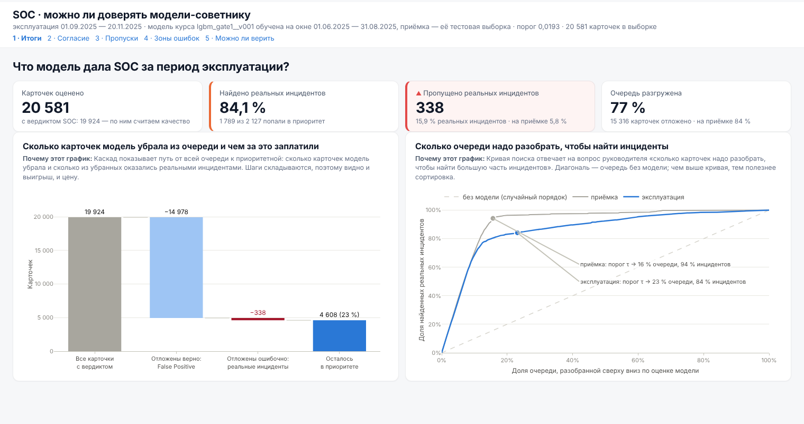

# Задание 2 · Можно ли доверять модели-советнику SOC

Дашборд Taipy для руководителя SOC, который не занимается машинным обучением. Модель курса `lgbm_gate1__v001` сортирует карточки инцидентов по вероятности того, что это реальный инцидент. Дашборд отвечает, можно ли ей доверять, и главная метрика в нём — **доля пропущенных реальных инцидентов**.

Каждая страница — один вопрос руководителя. Под заголовком каждого графика написано, почему выбран именно он. Выводы с цифрами лежат в [`REPORT.md`](REPORT.md).



*Превью страницы «Итоги»: те же Plotly-фигуры и KPI-плитки, элементы управления Taipy нарисованы статично. Остальные страницы — в папке [`docs`](docs).*

## Модель и периоды

Модель — `lgbm_gate1__v001` из пакета практик 3.6–3.7 (`IAVD_3.7_ML_team`): LightGBM на 1 099 признаках, рабочий порог **τ = 0,0193**. Курс выбрал его по максимуму F2 и менять не разрешает. Оценка ≥ τ — карточка в приоритет, ниже — в низкий приоритет. Реальный инцидент в низком приоритете — **пропуск**.

| Период | Даты | Что это |
|---|---|---|
| Окно обучения | 01.06.2025 — 31.08.2025 | 21 150 размеченных карточек, сплит 70 / 15 / 15 по месяцу и вердикту (seed 42) |
| **Приёмка** | то же окно, тестовая часть | 3 173 карточки, на которых курс опубликовал метрики: TP 390 / FP 107 / FN 24 / TN 2652 |
| **Эксплуатация** | 01.09.2025 — 20.11.2025 | 20 581 карточка после окна обучения; модель их не видела |

- **Сплит и метрики приёмки воспроизводятся кодом курса** (`course_ml.train.make_split`). `prepare.py` сверяет их с карточкой модели и печатает, совпали ли они.
- **Самопроверка.** Перед расчётом модель оценивает 5 контрольных карточек пакета и сверяет их с эталоном (допуск курса — 4·10⁻⁷).
- **Область модели** та же, что при обучении: у карточки есть правило корреляции SIEM, вендор не «Ручной ввод».
- **Метрики** считаются только по вердиктам «Решён» (y = 1) и «False Positive» (y = 0). Карточки без вердикта модель оценивает, но сверить их не с чем.

## Пять вопросов и графики

| Страница | Вопрос руководителя | Графики |
|---|---|---|
| 1 · Итоги | Что модель дала SOC за период эксплуатации? | каскад очереди «все → отложено → в приоритете», кривая поиска инцидентов |
| 2 · Согласие | Как часто модель соглашается с вердиктом аналитиков? | Санки «вердикт → решение модели», согласие на инцидентах и на FP по месяцам |
| 3 · Пропуски | Сколько реальных инцидентов модель пропускает? | доля пропусков по месяцам с 95 %-ными интервалами и уровнем приёмки, правила с пропусками |
| 4 · Зоны ошибок | Модель ошибается случайно или систематически? | точечная диаграмма срезов с интервалами (переключатели среза и типа ошибки), гистограммы оценок |
| 5 · Можно ли верить | Можно ли верить оценке и не устарела ли модель? | калибровка, гантели «приёмка → эксплуатация», три панели дрейфа: AUC, обогащение, доля инцидентов |

Почему выбран каждый график и чем он лучше альтернатив, расписано в таблице в конце [`REPORT.md`](REPORT.md).

**Фильтры** в шапке действуют на все страницы: месяц эксплуатации, организация, критичность и **порог модели**.
- Порог — это рабочий τ = 0,0193 и два варианта «что если»: «находить 99 % инцидентов приёмки» и 0,5. Модель они не меняют, только решение. На них видно, сколько пропусков и сколько лишней работы даёт каждый вариант. Уровень приёмки на графиках пересчитывается под выбранный порог.
- Графики по месяцам всегда показывают весь период; выбранный месяц обведён пунктиром.

Плитка с красной полосой и ▲ — сигнал, на который стоит обратить внимание. Пороги сигналов собраны в начале `dashboard_kpis.py`.

## Файлы

| Файл | Что внутри |
|---|---|
| `prepare.py` | датасет + пакет модели курса → сплит окна, самопроверка, оценки → `data/agg/scored.parquet` и `meta.json` |
| `course_model.py` | загрузка модели курса: совместимость с pandas 3 / scikit-learn 1.8+, вычисление деревьев на numpy, если нет lightgbm |
| `dashboard.py` | приложение Taipy: страницы, фильтры, обработчики |
| `dashboard_data.py` | загрузка, фильтры, метрики: матрица ошибок, интервал Уилсона, AUC, кривая поиска, калибровка, срезы |
| `dashboard_kpis.py` | KPI-плитки страниц и пороги сигналов |
| `dashboard_charts.py` | функции «данные → Plotly-фигура», палитра и тексты «почему этот график» (`WHY`) |
| `dashboard.css` | оформление (общий стиль с `task_1`) |
| `report.py` | собирает `REPORT.md` из тех же функций, что и плитки |
| `test_logic.py` | синтетические проверки без данных, без пакета курса и без запуска Taipy |

## Запуск

Нужно две вещи:

1. **Датасет** `iavd_ml_dataset.parquet` положите в `data_1/` в корне репозитория (как на Яндекс Диске) или в `task_2/data/`.
2. **Пакет модели курса** `IAVD_3.7_ML_team` (из материалов практики 3.7). `prepare.py` ищет его в `~/Downloads/IAVD_3.7_ML_team`, рядом с репозиторием или в `task_2/course_model/`. Можно указать путь явно через `--course-dir`.

Датасет, пакет модели и результаты расчёта в `.gitignore`: в репозиторий они не попадают.

Нужен Python 3.12, потому что свежий Taipy на PyPI не собран под 3.13 и 3.14. С conda:

```bash
cd task_2
conda create -y -n idav2 python=3.12
conda activate idav2
pip install "taipy>=4.1" plotly "pandas<3" numpy pyarrow scikit-learn scipy joblib pyyaml
python prepare.py                  # ~1 мин: самопроверка, сплит, оценки -> data/agg/
python dashboard.py                # http://localhost:5003
```

`lightgbm` ставить не обязательно: без него `course_model.py` считает деревья модели на numpy, результат тот же. Если lightgbm установлен, используется он. На macOS ему дополнительно нужен `brew install libomp`.

Порт 5003 выбран, чтобы дашборд можно было держать открытым рядом с дашбордом первого задания (5002).

Пересобрать отчёт: `python report.py`. Проверки логики: `python -m unittest test_logic.py`.

## Палитра

Цвета те же, что в `task_1`, и одинаковые на всех графиках: синий — False Positive, оранжевый — реальный инцидент в приоритете, серый — приёмка (эталон), синий — эксплуатация. Пропущенные инциденты — тёмно-красный `#a3162b`: красный из `task_1` рядом с оранжевым не проходит проверку на различимость при дальтонизме, а этот проходит. У каждой серии есть подпись или легенда, поэтому цвет — не единственный носитель смысла.
