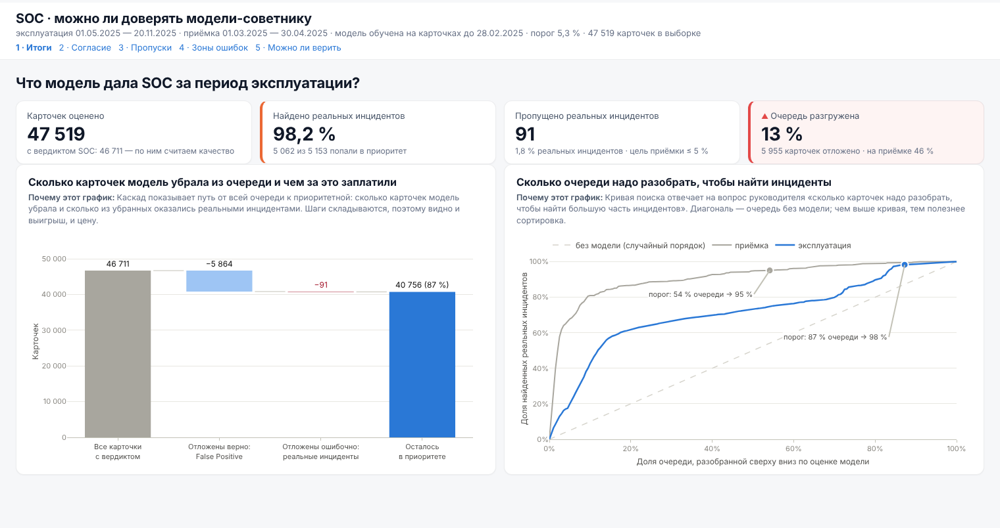

# Задание 2 · Можно ли доверять модели-советнику SOC

Дашборд Taipy для руководителя SOC, который не занимается машинным обучением. Модель сортирует карточки инцидентов по вероятности того, что это реальный инцидент. Дашборд отвечает, можно ли ей доверять, и главная метрика в нём — **доля пропущенных реальных инцидентов**.

Каждая страница — один вопрос руководителя. Под заголовком каждого графика написано, почему выбран именно он. Выводы с цифрами лежат в [`REPORT.md`](REPORT.md).



*Превью страницы «Итоги»: те же Plotly-фигуры и KPI-плитки, элементы управления Taipy нарисованы статично. Остальные страницы — в папке [`docs`](docs).*

## Как устроен эксперимент

В датасете `iavd_ml_dataset.parquet` нет готовых предсказаний, поэтому `prepare.py` воспроизводит жизненный цикл модели по времени:

| Этап | Период | Что происходит |
|---|---|---|
| Обучение | 12.04.2024 — 28.02.2025 | модель учится на вердиктах аналитиков: 133 324 карточки, 18,6 % реальных инцидентов |
| Приёмка | 01.03.2025 — 30.04.2025 | порог выбирается так, чтобы модель находила ≥ 95 % реальных инцидентов (пропускала ≤ 5 %) |
| Эксплуатация | 01.05.2025 — 20.11.2025 | модель с этим порогом оценивает 47 519 карточек, её решения сверяются с вердиктами SOC |

- **Реальный инцидент** — вердикт «Решён», **False Positive** — вердикт «False Positive». Дубликаты, спам и карточки без вердикта модель оценивает, но в метрики они не входят.
- **Признаки** — только то, что известно при создании карточки: правило SIEM, критичность, категория IRP, организация, поля события, командная строка. Решение, комментарии, принятые меры и времена обработки в модель не идут, иначе это утечка ответа.
- **Модель** — `HistGradientBoostingClassifier` из scikit-learn с нативными категориальными признаками.
- **Порог** = «низкий приоритет». Оценка ниже порога — модель считает карточку ложной и откладывает её. Реальный инцидент в низком приоритете — **пропуск**.

## Пять вопросов и графики

| Страница | Вопрос руководителя | Графики |
|---|---|---|
| 1 · Итоги | Что модель дала SOC за период эксплуатации? | каскад очереди «все → отложено → в приоритете», кривая поиска инцидентов |
| 2 · Согласие | Как часто модель соглашается с вердиктом аналитиков? | Санки «вердикт → решение модели», согласие на инцидентах и на FP по месяцам |
| 3 · Пропуски | Сколько реальных инцидентов модель пропускает? | доля пропусков по месяцам с 95 %-ными интервалами и целью приёмки, правила с пропусками |
| 4 · Зоны ошибок | Модель ошибается случайно или систематически? | точечная диаграмма срезов с интервалами (переключатели среза и типа ошибки), гистограмма оценок у порога |
| 5 · Можно ли верить | Можно ли верить оценке и не устарела ли модель? | калибровка, гантели «приёмка → эксплуатация», три панели дрейфа по месяцам |

Почему выбран каждый график и чем он лучше альтернатив, расписано в таблице в конце [`REPORT.md`](REPORT.md).

**Фильтры** (в шапке, действуют на все страницы): месяц эксплуатации, организация, критичность и **порог модели**. Варианты порога — «Находить 90 / 95 / 99 % инцидентов», все выбраны на приёмке. Это «что если» для руководителя: видно, сколько пропусков и сколько лишней работы даёт каждый вариант. Графики по месяцам всегда показывают весь период, выбранный месяц обведён пунктиром.

Плитка с красной полосой и ▲ — сигнал, на который стоит обратить внимание. Пороги сигналов собраны в начале `dashboard_kpis.py`.

## Файлы

| Файл | Что внутри |
|---|---|
| `prepare.py` | сырой parquet → признаки → модель → порог → `data/agg/scored.parquet` и `meta.json` |
| `dashboard.py` | приложение Taipy: страницы, фильтры, обработчики |
| `dashboard_data.py` | загрузка, фильтры, метрики: матрица ошибок, интервал Уилсона, AUC, кривая поиска, калибровка, срезы |
| `dashboard_kpis.py` | KPI-плитки страниц и пороги сигналов |
| `dashboard_charts.py` | функции «данные → Plotly-фигура», палитра и тексты «почему этот график» (`WHY`) |
| `dashboard.css` | оформление (общий стиль с `task_1`) |
| `report.py` | собирает `REPORT.md` из тех же функций, что и плитки |
| `test_logic.py` | синтетические проверки без parquet и без запуска Taipy |

## Запуск

Нужен Python 3.12: свежий Taipy на PyPI не собран под 3.13 и 3.14.

Датасет `iavd_ml_dataset.parquet` положите в `data_1/` в корне репозитория (как на Яндекс Диске) или в `task_2/data/`. Обе папки в `.gitignore`.

```bash
cd task_2
uv venv .venv --python 3.12
uv pip install --python .venv/bin/python "taipy>=4.1" plotly "pandas<3" numpy pyarrow scikit-learn
.venv/bin/python prepare.py        # ~30 с: признаки, модель, оценки -> data/agg/
.venv/bin/python dashboard.py      # http://localhost:5003
```

Порт 5003, чтобы дашборд можно было держать открытым рядом с дашбордом первого задания (5002).

Пересобрать отчёт: `.venv/bin/python report.py`. Проверки логики: `.venv/bin/python -m unittest test_logic.py`.

## Палитра

Цвета те же, что в `task_1`, и одинаковые на всех графиках: синий — False Positive, оранжевый — реальный инцидент в приоритете, серый — приёмка (эталон), синий — эксплуатация. Пропущенные инциденты — тёмно-красный `#a3162b`: красный из `task_1` рядом с оранжевым не проходит проверку на различимость при дальтонизме, а этот проходит. У каждой серии есть подпись или легенда, поэтому цвет — не единственный носитель смысла.
