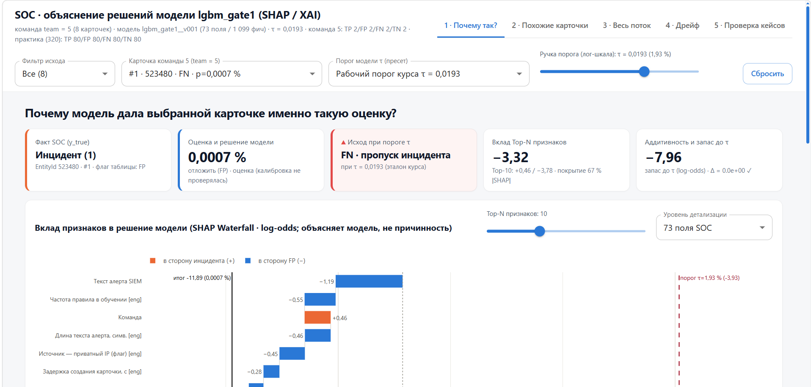

# Задание 3 · Объяснимость модели-советника SOC (SHAP / XAI)

Дашборд Taipy для аналитиков и руководителя SOC, который делает решения модели курса `lgbm_gate1__v001` **понятными и проверяемыми** на трёх уровнях: одна карточка, группа похожих карточек и весь поток. Работа выполнена для индивидуального набора команды **`team = 5`** (8 карточек из `3.7_Пр_cards_practice.xlsx`).

Каждая страница отвечает на один вопрос SOC. На листах — только KPI-плитки, интерактивные элементы управления и графики; развёрнутые выводы, разбор кейсов и таблица «почему выбран именно этот график» собраны в [`REPORT.md`](REPORT.md), а 1-страничная записка для сдачи практики 3.7 — в [`NOTE_3.7.md`](NOTE_3.7.md).



*Превью страницы «Почему так?» (скриншоты всех вкладок — в папке [`docs`](docs)).*

## Модель, данные и сверки

Модель — `lgbm_gate1__v001` из пакета практик 3.6–3.7 (`IAVD_3.7_ML_team`): LightGBM на **1 099 фичах**, сгруппированных по `feature_mapping.csv` в **73 поля** (30 исходных полей карточки и 43 сконструированных числовых признака `engineered`). Рабочий порог курса — **τ = 0,0193** (`logit(τ) = −3,9282`, базовый уровень модели `base = −8,8524`).

| Срез | Объём | Назначение в дашборде |
|---|---:|---|
| **Команда 5 (`team = 5`)** | 8 карточек (2 TP / 2 FP / 2 FN / 2 TN) | Локальный разбор (Waterfall, Top-N, поля карточки, кейсы проверки) |
| **Практика 320** | 320 карточек (40 команд × 8, сентябрь 2025) | Сверка с `course_pack/shap_cards.csv`, сравнение важности по выборкам |
| **Приёмка** | 3 173 карточки (тест-сплит 01.06–31.08.2025) | Эталон распределения признаков и вкладов SHAP до дрейфа |
| **Эксплуатация** | 20 581 карточка (01.09–20.11.2025) | Глобальные профили (Beeswarm, ALE/PDP/ICE, group-PDP), дрейф и 95 % ДИ Уилсона |
| **Вся область модели** | ~41,7 тыс. карточек (обучение + приёмка + прод) | Фоновая карта похожести (`Hexbin`) и многомерный поиск 20 ближайших соседей |

- **Аддитивность SHAP** проверяется автоматически в `prepare.py` на всей области модели: `|σ(base + Σ shap_73) − proba| ≤ 10⁻⁶`.
- **Сверка с эталоном курса:** 5 контрольных карточек (`control_cards.csv`, допуск `4·10⁻⁷`), официальный `course_pack/shap_cards.csv` и все 8 исходов команды 5 при `τ = 0,0193`.
- **Порог τ в режиме «что если»:** в шапке доступны пресеты (включая `0,0350`, который убирает оба FP команды 5) и логарифмическая ручка `log10(τ)` от `10⁻⁵` до `1`. При любом изменении порога в шапке пересчитывается матрица ошибок для команды 5 и всех 320 карточек практики.

## Пять страниц и графики

| Страница | Вопрос SOC | Графики |
|---|---|---|
| 1 · Почему так? | Почему модель дала выбранной карточке такую оценку и что изменит порог? | SHAP Waterfall (`base → Top-N → Прочие → итог` + линия τ), дивергентная полоса баланса (`+` vs `−`), полная таблица 73 полей с пометкой `сконструирован` |
| 2 · Похожие карточки | Насколько похожие вердикты получают похожие карточки в потоке? | Двухслойная карта похожести (`Hexbin` ~41,7 тыс. карточек в SHAP-PCA / SVD-20 / t-SNE + 8 карточек команды 5 + 20-NN), Violin + strip вкладов группы, таблица 20 ближайших соседей |
| 3 · Весь поток | На какие сигналы модель опирается в целом и как признаки влияют на скор? | SHAP Summary Plot (Beeswarm), Dot Plot важности по трём выборкам + Ablation, ALE + PDP + ICE (с авто-предупреждением о мультиколлинеарности `|ρ| ≥ 0,70`) и group-PDP для 12 категорий |
| 4 · Дрейф | Как изменились распределения признаков и их вклады от приёмки к эксплуатации? | Гантели `mean|SHAP|` (Приёмка → Эксплуатация) с индексом PSI, сравнительные профили распределений и пропусков |
| 5 · Проверка кейсов | Где объяснение модели подтверждается данными, а где выглядит сомнительно? | Двухпанельная сверка топ-12 вкладов SHAP с фактической долей инцидентов и 95 % ДИ Уилсона, детальная таблица и кураторские кейсы (`#7 · 521996` подтверждён; `#4 · 526930` и `#1 · 523480` сомнительны) |

Обоснование выбора каждого графика хранится в `WHY` и `WHY_ALT` в `dashboard_charts.py` и автоматически попадает в таблицу в конце [`REPORT.md`](REPORT.md).

## Файлы

| Файл | Что внутри |
|---|---|
| `feature_registry.py` | реестр 73 полей (`card` / `engineered`, `last_step`, допустимые XAI-методы) и матрица группировки `1099 → 73` |
| `course_model.py` | обёртка модели курса: совместимость pandas 2 / sklearn 1.8+, быстрый `pred_contrib` TreeSHAP и сверки § 4 |
| `prepare.py` | офлайн-расчёт SHAP, Ablation, ALE/PDP/ICE, group-PDP, PSI-дрейфа, Hexbin-карт, 20-NN и ДИ Уилсона → `data/agg/` |
| `dashboard_data.py` | единая загрузка `data/agg/` при старте, пересчёт при сдвиге τ, срез `Top-N`, таблицы карточки и верификации |
| `dashboard_kpis.py` | KPI-плитки всех 5 страниц и пороги тревожных сигналов (`kpi-alert`) |
| `dashboard_charts.py` | Plotly-фигуры (палитра `task_1`/`task_2`) и словари обоснований `WHY` / `WHY_ALT` |
| `dashboard.py` | приложение Taipy: 5 страниц, шапка с ручкой порога, обработчики состояния (порт `5004`) |
| `dashboard.css` | стили (общий визуальный язык с `task_1` и `task_2`) |
| `report.py` | автогенератор [`REPORT.md`](REPORT.md) и записки [`NOTE_3.7.md`](NOTE_3.7.md) |
| `test_logic.py` | синтетические проверки без запуска Taipy (реестр, аддитивность `Top-N`, сдвиг τ, ДИ Уилсона, PSI, Hexbin) |

## Запуск

Нужны исходный датасет `iavd_ml_dataset.parquet`, пакет модели `IAVD_3.7_ML_team` (находится автоматически в `../task_2/course_model/`) и таблица `3.7_Пр_cards_practice.xlsx` в корне репозитория.

В окружении с Python 3.12 (с установленным `lightgbm` для точного TreeSHAP):

```bash
cd task_3
pip install "taipy>=4.1" plotly "pandas<3" numpy pyarrow scikit-learn scipy joblib lightgbm openpyxl
python prepare.py                    # ~1,5–2 мин: расчёт артефактов -> data/agg/
python -m unittest test_logic.py     # синтетические проверки логики
python report.py                     # пересобрать REPORT.md и NOTE_3.7.md
python dashboard.py                  # http://localhost:5004
```

Порт `5004` выбран так, чтобы дашборды всех трёх заданий (`5002`, `5003`, `5004`) можно было держать открытыми одновременно.

## Палитра

Наследуется от `task_1` и `task_2`: синий `#2a78d6` — False Positive и отрицательный вклад SHAP (к FP), оранжевый `#eb6834` — реальный инцидент и положительный вклад SHAP (к инциденту), тёмно-красный `#a3162b` — пропуск инцидента (`FN`), линия порога τ и статистические противоречия (проверен на различимость рядом с оранжевым при дальтонизме), серый `#a8a69e` — приёмка (эталон) и базовый уровень. Все серии продублированы подписями или символами (`+` / `−`, формой маркеров).
